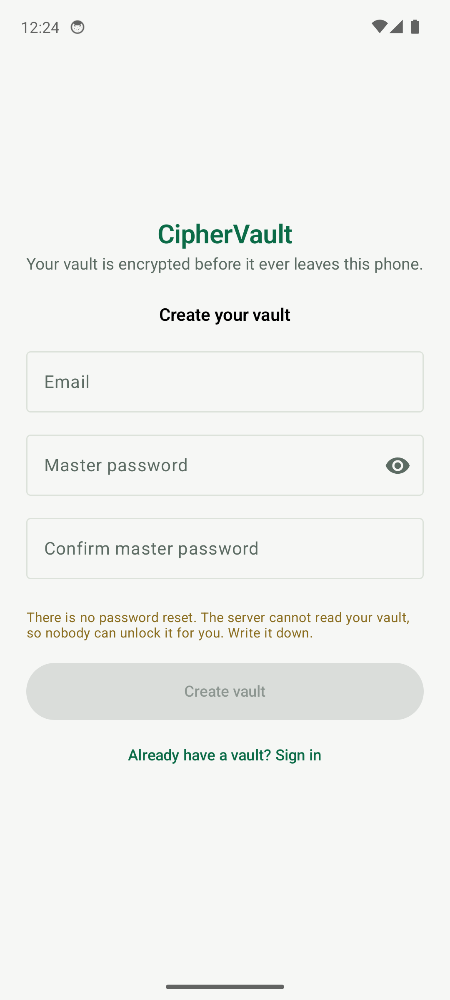
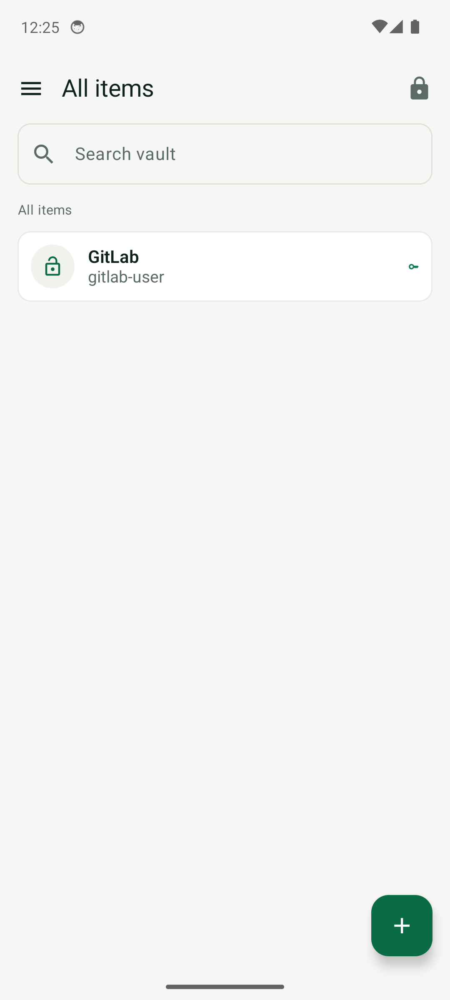
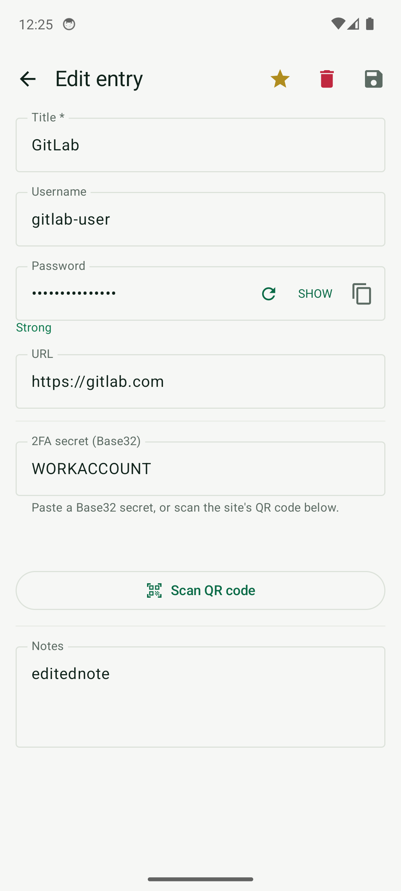
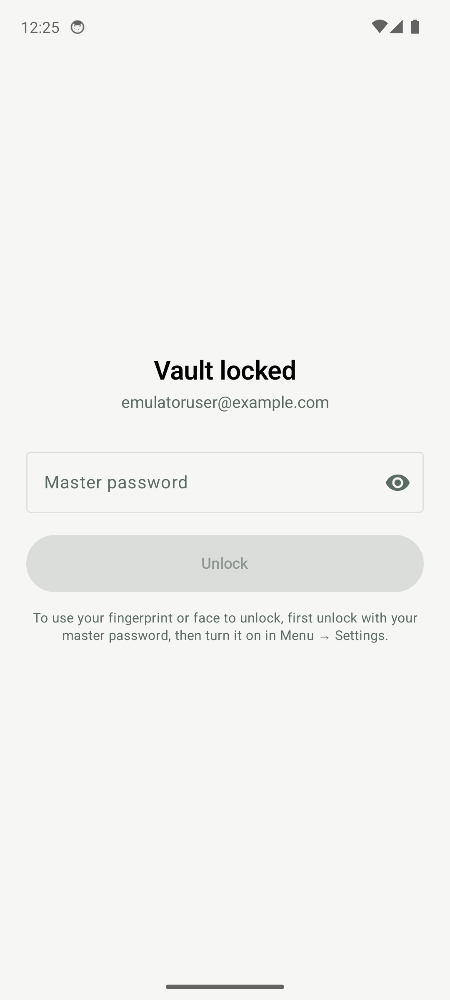

# CipherVault

[](https://github.com/swapnashu/ciphervault/releases/latest)
[](LICENSE)
[](https://swapnashu.github.io/ciphervault/)
[-3DDC84?style=flat-square)](https://github.com/swapnashu/ciphervault/releases/latest)
[](https://github.com/swapnashu/ciphervault/releases/tag/addon-v1.0.0)

**Zero-knowledge password manager for Android — plus a browser add-on**
for Chrome, Edge, Brave and Firefox. Your vault is encrypted on the device
before it ever reaches the server. Kotlin + Jetpack Compose, offline-first,
open source (Apache-2.0).

**Website & privacy policy:** [swapnashu.github.io/ciphervault](https://swapnashu.github.io/ciphervault/)
&nbsp;·&nbsp; **APK:** [latest release](https://github.com/swapnashu/ciphervault/releases/latest)

## Screenshots

| | | | |
| --- | --- | --- | --- |
|  |  |  |  |

## Features

- **Five entry types** — logins, secure notes, cards, identities, and TOTP seeds,
  with custom fields and favorites
- **Real cryptography** — Argon2id (PBKDF2-SHA256 600k for legacy accounts with
  automatic migration), HKDF sub-keys, AES-256-GCM blobs bound to account and revision
- **Autofill** — fill and save credentials in other apps, domain-aware matching
- **Authenticator** — on-device TOTP codes, QR scanner, `otpauth://` link support
- **Security dashboard** — password-hygiene audit and Have I Been Pwned
  k-anonymity breach checks (the password never leaves the device)
- **Multi-device sync** — offline-first vault, revision-conflict handling,
  atomic password change with session revocation, active-session management
- **Biometrics** — hardware-backed key wrapping, StrongBox/TEE, optional face unlock
- **Hardened UI** — FLAG_SECURE release builds, clipboard auto-clear,
  no cloud backups, certificate pinning (ISRG Root X1)

## Browser add-on

Fill and save vault logins in the browser with the same zero-knowledge
protocol. The add-on keeps only derived keys in browser memory
(`storage.session`, cleared on exit), fills login forms app-style, and
captures + merges new logins with the app-server revision scheme.

Details and install steps: [`extension/README.md`](extension/README.md) ·
[zips (addon-v1.0.0)](https://github.com/swapnashu/ciphervault/releases/tag/addon-v1.0.0).

## Security model

Vault keys are derived on the device and never leave it. The sync server
stores only ciphertext, verifier hashes and rate-limit/audit metadata — it
cannot read your vault or reset your master password. Details on the
[website](https://swapnashu.github.io/ciphervault/#security).

## Build

Open `android_vault/` in Android Studio (JDK 17+). Debug builds use the
`.debug` application-id suffix and can sit side-by-side with release.

```bash
gradlew :app:assembleDebug
gradlew :app:assembleRelease   # needs your signing config
```

Release signing: `android_vault/keystore.properties` + your keystore
(gitignored — **back them up yourself**). Store metadata lives in
`android_vault/fastlane/metadata/`; regenerate raster assets from the
launcher vector with `python android_vault/fastlane/make_store_assets.py`.

## Known limitations

- **F-Droid:** on-device ML Kit barcode scanning is rejected by F-Droid's
  anti-features policy; distribution is Play/release-APK focused. The core
  vault has no analytics, ads or trackers.
- **No password recovery** — by design: the server cannot decrypt vaults.

## License

Apache License 2.0 — see [LICENSE](LICENSE).
